  

---

###  English — About Me
Hi, I'm **Alireza** — a Computer Science enthusiast and software developer focused on **Software & System Architecture** and building practical apps people actually use.

- 💡 **From Idea to Working Product:** I enjoy taking a concept from a blank screen to a clean, reliable application — whether it's an interactive JavaScript tool, a tailored WordPress store, or a lightweight backend service.
- 🎓 **Computer Science & Architecture:** Currently deepening my foundations in **Object-Oriented Programming (OOP)**, system design, and clean code structure.
- 🌐 **Web, WordPress & Cloud:** Hands-on experience with **JavaScript, TypeScript, PHP**, custom WordPress themes, automated PDF invoicing, and edge deployments on **Cloudflare Workers**.
- 🛠️ **Practical Workflow:** I use modern AI tools as an everyday engineering assistant to speed up prototyping, testing, and UI refinement.

| What I Build | Focus & Capabilities |
| :--- | :--- |
| **Interactive Web Apps** | Vanilla JS & TypeScript apps, clean DOM architecture, custom calendar/state engines, and responsive interfaces |
| **Custom WordPress & PHP** | Tailored WordPress themes, WooCommerce customization, custom PHP logic, and automated PDF invoices |
| **Backend & Edge Services** | Server-side PHP, JSON/REST APIs, and fast serverless deployments on Cloudflare Workers |
| **System Architecture** | Modular code structure, maintainable design patterns, and performance-focused builds |

---

###  Deutsch — Über mich
Hallo, ich bin **Alireza** — ich beschäftige mich intensiv mit **Informatik**, **Software- und Systemarchitektur** und entwickle praktische Webanwendungen für den echten Einsatz.

- 💡 **Von der Idee zum fertigen Produkt:** Mir macht es Spaß, Konzepte von Grund auf in sauber strukturierte, funktionierende Anwendungen zu verwandeln — von interaktiven JavaScript-Tools bis hin zu individuellen WordPress- und PHP-Lösungen.
- 🎓 **Informatik & Architektur:** Aktuell vertiefe ich meine Grundlagen in **objektorientierter Programmierung (OOP)**, Systemdesign und sauberer Codestruktur.
- 🌐 **Web, WordPress & Cloud:** Praktische Erfahrung mit **JavaScript, TypeScript, PHP**, maßgeschneiderten WordPress-Themes, automatischer PDF-Rechnungserstellung und Edge-Deployments auf **Cloudflare Workers**.
- 🛠️ **Praxisnaher Workflow:** Moderne KI-Tools nutze ich gezielt als Entwicklungsassistenten, um Prototypen und Oberflächen schneller zu testen und umzusetzen.

| Was ich entwickle | Fokus & Kompetenzen |
| :--- | :--- |
| **Interaktive Web-Apps** | Vanilla JS & TypeScript Anwendungen, saubere DOM-Architektur, eigene Kalender-Engines und responsive Oberflächen |
| **WordPress & PHP** | Individuelle WordPress-Themes, WooCommerce-Anpassungen, eigene PHP-Logik und automatische PDF-Rechnungen |
| **Backend & Edge Services** | Serverseitiges PHP, JSON/REST-APIs und schnelle Serverless-Deployments mit Cloudflare Workers |
| **Systemarchitektur** | Modularer Code, wartbare Design-Patterns und performante Web-Lösungen |

---

###  فارسی — درباره من
سلام، من **علیرضا** هستم؛ علاقه‌مند به **علوم کامپیوتر** و **معماری نرم‌افزار و سیستم** که تمرکز اصلی‌ام روی ساخت برنامه‌ها و ابزارهای کاربردی و واقعی است.

<ul dir="rtl" align="right">
  <li>💡 <strong>از ایده تا محصول واقعی:</strong> از تبدیل کردن یک ایده خام به یک برنامه تمیز و قابل استفاده لذت می‌برم؛ چه یک وب‌اپلیکیشن تعاملی با جاوااسکریپت باشد، چه یک قالب اختصاصی وردپرس یا یک سرویس سبک سمت سرور.</li>
  <li>🎓 <strong>علوم کامپیوتر و معماری سیستم:</strong> این روزها در حال عمیق‌تر کردن دانشم در <strong>برنامه‌نویسی شی‌ءگرا (OOP)</strong>، طراحی سیستم و اصول کدنویسی تمیز هستم.</li>
  <li>🌐 <strong>وب، وردپرس و رایانش ابری:</strong> تجربه عملی در توسعه با <strong>JavaScript، TypeScript و PHP</strong>، طراحی قالب‌های سفارشی وردپرس، صدور خودکار فاکتور PDF و اجرای سرویس‌ها روی <strong>Cloudflare Workers</strong> دارم.</li>
  <li>🛠️ <strong>روند کاری مدرن:</strong> از ابزارهای هوش مصنوعی به‌عنوان دستیار عملی در کنار کدنویسی استفاده می‌کنم تا فرآیند نمونه‌سازی و تست ایده‌ها سریع‌تر و دقیق‌تر پیش برود.</li>
</ul>

<table dir="rtl" width="100%">
  <thead>
    <tr>
      <th align="right" width="28%">حوزه کاری</th>
      <th align="right" width="72%">کارهایی که انجام می‌دهم</th>
    </tr>
  </thead>
  <tbody>
    <tr>
      <td align="right"><strong>وب‌اپلیکیشن‌های تعاملی</strong></td>
      <td align="right">ساخت برنامه‌های کاربردی با Vanilla JS و TypeScript، معماری تمیز DOM، موتورهای اختصاصی تقویم و رابط کاربری واکنش‌گرا</td>
    </tr>
    <tr>
      <td align="right"><strong>وردپرس و PHP اختصاصی</strong></td>
      <td align="right">طراحی قالب‌های سفارشی وردپرس، شخصی‌سازی ووکامرس، کدنویسی اختصاصی PHP و صدور خودکار فاکتور PDF</td>
    </tr>
    <tr>
      <td align="right"><strong>بک‌اند و سرویس‌های ابری</strong></td>
      <td align="right">پیاده‌سازی منطق سمت سرور با PHP، کار با JSON/REST API و اجرای سرویس‌ها روی Cloudflare Workers</td>
    </tr>
    <tr>
      <td align="right"><strong>معماری سیستم</strong></td>
      <td align="right">کدنویسی ماژولار و قابل نگهداری، استفاده از الگوهای طراحی استاندارد و بهینه‌سازی سرعت</td>
    </tr>
  </tbody>
</table>

---

### 🛠️ Tech Stack & Tools | Technologien | ابزارها و تکنولوژی‌ها

  
  
  
  
  
   
  
  
  
  
  

---

### 📊 GitHub Stats | Statistiken | آمار گیت‌هاب

  
  

